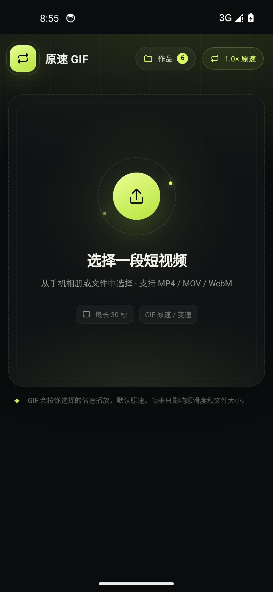
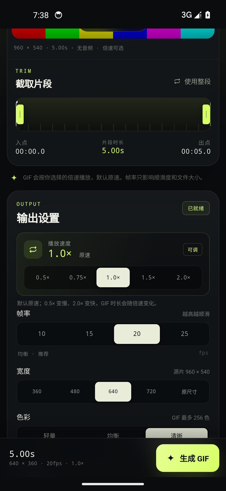
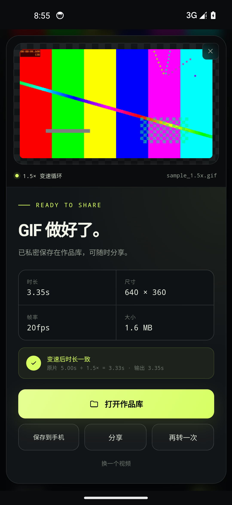
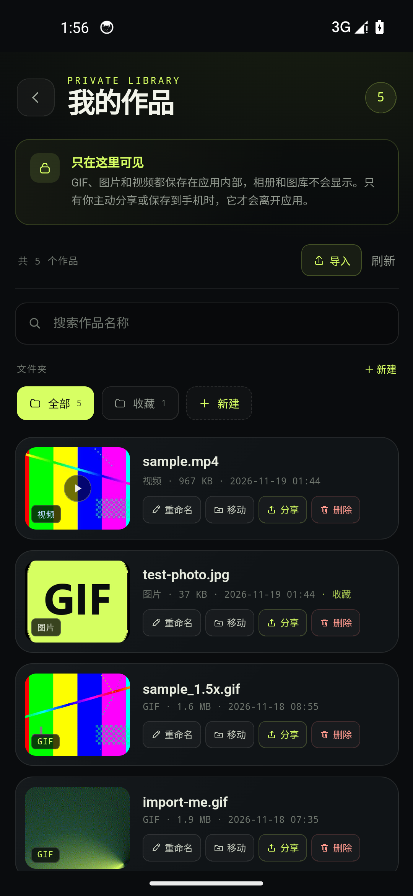
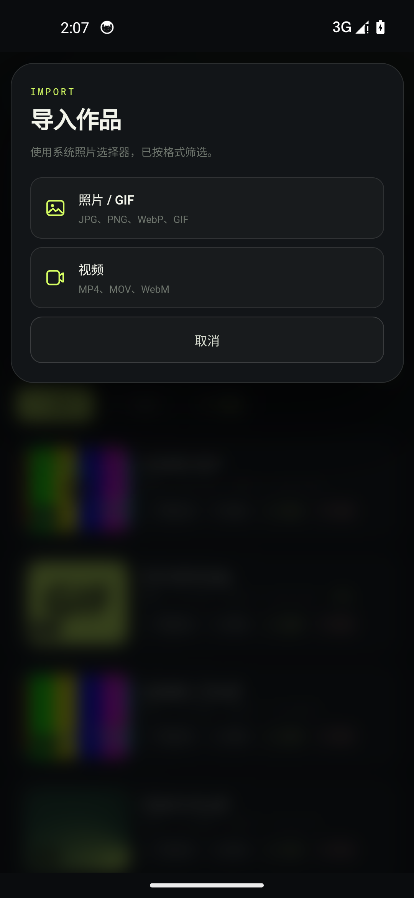
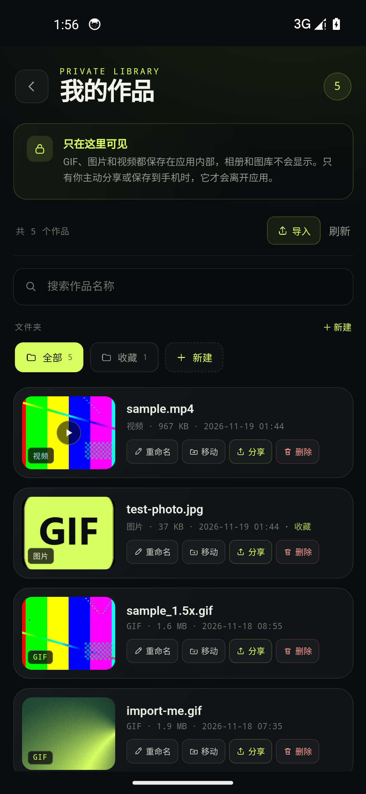
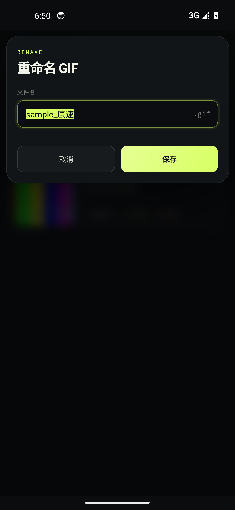

# 原速 GIF · Android

把手机里的短视频截一段，生成 GIF。**默认原速**，也可以选择 0.5×–2.0× 加快或减慢。

v1.3 起，作品库不再只管理 GIF：**GIF、图片、视频**都可以导入同一个私密多媒体库，支持按名称搜索、文件夹、重命名、移动、分享和删除。默认情况下，相册和图库看不到这些文件；只有主动分享，或点「保存到手机」明确导出时，文件才会以原格式离开应用。

**安装包：[原速GIF.apk](原速GIF.apk)**（v1.3.2，约 9.9 MB，Android 10+）



- 默认 `1.0×` 原速，可选 `0.5× / 0.75× / 1.0× / 1.5× / 2.0×`。
- 转换完成自动保存到私密作品库。
- 私密多媒体库：GIF / 图片 / 视频统一管理，支持搜索和文件夹。
- 选视频、导入图片/GIF/视频使用系统**照片选择器**，并按格式筛选，不再打开文件管理器。
- 结果页和单个作品预览页都有「保存到手机」，点了才会写入相册。
- 作品库支持**导入**：复制到应用内部，原文件从相册删除也不影响。
- 重命名、移动、分享、删除、预览。

## 安装

1. 把 `原速GIF.apk` 传到 Android 手机。
2. 点击安装，按系统提示允许“安装未知应用”。
3. 打开「原速 GIF」。

APK **没有申请 INTERNET、相册读取或存储权限**，页面、FFmpeg WASM 引擎和作品文件全部在应用内部。

## 版本归档与回退

每个版本的 APK 都保留在 [`releases/`](releases/RELEASES.md)，根目录的 `原速GIF.apk` 只是当前最新版的快捷副本，**不要用它回退**。

| 版本 | APK | 说明 |
| --- | --- | --- |
| v1.0.0 | [YuansuGIF-v1.0.0.apk](releases/v1.0.0/YuansuGIF-v1.0.0.apk) | 首版；保存到相册 |
| v1.1.0 | [YuansuGIF-v1.1.0.apk](releases/v1.1.0/YuansuGIF-v1.1.0.apk) | 私密作品库；重命名/分享/删除 |
| v1.2.0 | [YuansuGIF-v1.2.0.apk](releases/v1.2.0/YuansuGIF-v1.2.0.apk) | 保存到手机；导入 GIF；0.5×–2.0× 变速 |
| v1.3.0 | [YuansuGIF-v1.3.0.apk](releases/v1.3.0/YuansuGIF-v1.3.0.apk) | 私密多媒体库；图片/视频导入；搜索；文件夹；大小预估修正 |
| v1.3.1 | [YuansuGIF-v1.3.1.apk](releases/v1.3.1/YuansuGIF-v1.3.1.apk) | 修复视频卡片缩略图点击预览 |
| v1.3.2 | [YuansuGIF-v1.3.2.apk](releases/v1.3.2/YuansuGIF-v1.3.2.apk) | 视频/图片改用系统照片选择器，按格式筛选 |

每个版本目录都有 `version.json`、`SHA256.txt` 和 `RELEASE_NOTES.md`。

**回退时注意：**

1. 优先直接覆盖安装旧版 APK。
2. 如果系统提示版本降级，可用 `adb install -r -d YuansuGIF-v1.0.0.apk`；或者卸载新版再安装。
3. **卸载会删除应用内部作品库里的 GIF**，回退前先把需要的作品分享出去。
4. 旧版 v1.0.0 会默认把 GIF 写入相册；v1.1.0 默认不写，v1.2.0 起只有主动点「保存到手机」才写。

新版本构建会自动归档，且**同一个版本号如果内容不同会被拒绝覆盖**，必须先修改 `android:versionCode` 和 `android:versionName`。

## 使用

1. 点首页大按钮，从相册或文件中选择视频（MP4 / MOV / WebM）。
2. 拖动时间轴两端的黄色手柄截取片段；「试看所选片段」可循环预览。
3. 选择播放速度、帧率、宽度、色彩数和是否循环。默认 `1.0×` 原速。
4. 点底部「生成 GIF」。
5. 生成完成后会**自动保存到作品库**。结果页可以：
   - 打开作品库；
   - **保存到手机**（明确导出到相册）；
   - 分享；
   - 再转一次。
6. 在作品库点「导入」可以把手机里已有的 GIF、图片或视频复制进来管理；导入后原文件可以从相册删除，不影响作品库。
7. 用顶部搜索框按名称查找；用「文件夹」整理作品，作品可以移动到不同文件夹。

### 选择器

- 转 GIF 选择视频时，使用系统**照片选择器**（Android 13+ `ACTION_PICK_IMAGES`），只显示视频。
- 作品库「导入」会先选类型：
  - **照片 / GIF**：只显示图片格式，包含 JPG、PNG、WebP、GIF；
  - **视频**：只显示视频格式，包含 MP4、MOV、WebM 等。
- Android 10–12 没有系统照片选择器时，回退到系统相册选择器，仍然不打开文件管理器。
- 不再使用 `ACTION_OPEN_DOCUMENT` 文件选择器。

| 输出设置 | 结果 |
| --- | --- |
|  |  |

### 播放速度

- `1.0×` 保持原片速度；`0.5×` 变慢，`2.0×` 变快。
- 片段按倍速重新计时：输出时长 ≈ 片段时长 ÷ 倍速。
- 例如 5.00 秒片段：
  - `2.0×` → 约 2.50 秒；
  - `0.5×` → 10.00 秒；
  - `1.5×` → 约 3.33 秒。
- 慢放会让 GIF 变长、文件更大；如果太大，可以减少片段长度、降低帧率或宽度。

## 私密作品库

点右上角「作品」进入。库里可以放 GIF、图片和视频，每个作品都可以：

- **预览**：点击缩略图查看；视频可直接在应用内播放。
- **重命名**：只改应用内部的文件名和扩展名，不会产生相册副本。
- **移动**：把作品放进不同文件夹；文件夹是应用内虚拟目录。
- **分享**：通过只读 ContentProvider 临时授权给目标应用，按原格式发送（`image/gif`、`image/jpeg`、`video/mp4` 等），不会进入你的相册。
- **保存到手机**：明确复制一份到系统相册（图片/GIF 到 `Pictures/原速GIF`，视频到 `Movies/原速GIF`）；应用内部原件仍然保留。
- **删除**：二次确认后从应用内部永久删除。
- **搜索**：按文件名搜索，覆盖全部文件夹。
- **文件夹**：新建、重命名、删除文件夹；删除文件夹时里面的作品会移回「全部作品」，不会删除文件。
- **导入**：从系统文件选择器选 GIF、图片或视频，复制进作品库。导入后删除相册里的原文件，不会影响作品库里的副本。









### 隐私设计

- 转换和导入的 GIF、图片、视频默认存放在应用内部目录：`/data/data/com.yuansu.gif/files/gifs/`。
- 默认不写入 MediaStore，也不写入 `Pictures/`、`DCIM/` 等公共目录；相册、图库扫描不到。
- 只有用户主动点「保存到手机」时，才通过 MediaStore 在 `Pictures/原速GIF`（图片/GIF）或 `Movies/原速GIF`（视频）写一份**相册副本**。
- 相册副本和应用内原件互不影响：删除相册里的副本，作品库仍在；删除作品库里的原件，也不会删除已经导出的相册副本。
- 分享时使用 `content://com.yuansu.gif.files/file/<name>` 临时 URI，只授予接收方读取这一份文件；MIME 按原格式返回。
- **导入是复制**：应用读取你选择的文件并写入自己的内部目录，之后原文件删除、移动都不影响副本。
- 视频缩略图单独生成在内部 `.thumbs/`，同样不进入相册。
- 没有 `INTERNET` 权限；没有 `READ_MEDIA_*`、`WRITE_EXTERNAL_STORAGE` 等相册权限。保存到相册使用 Android 10+ 的 MediaStore 自己写入，不需要存储权限。
- `allowBackup=false`，作品不会进入云备份。
- **卸载应用会删除作品库里的所有文件**，需要保留的作品请先分享或保存到手机。

> 旧版本（v1.0）曾把 GIF 保存到 `Pictures/原速GIF`。v1.1 不会自动删除这些历史文件；如果你需要清理，可以在系统相册或文件管理器里手动删除该文件夹。v1.2 起默认不再写相册，只有主动「保存到手机」才写。

## 速度实现

播放速度在 FFmpeg 滤镜里通过 `setpts=PTS/<speed>` 改变时间戳，再做 `fps`、缩放和两遍调色板编码：

- `1.0×` 不插入 `setpts`，保持原时间戳。
- `2.0×` → `setpts=PTS/2`，输出时长减半。
- `0.5×` → `setpts=PTS/0.5`，输出时长加倍。
- GIF 帧率仍按设置写入；速度通过帧数和时间戳体现，不改变音视频同步（GIF 无音频）。
- 结果页会显示实际时长和按倍速计算的预期时长，偏差超过一帧会标黄提示。

Android 14 模拟器实测（5.00 秒源片段，20fps，640×360）：

| 倍速 | 预期 | 实际 |
| --- | --- | --- |
| 0.5× | 10.00s | **10.00s** |
| 1.0× | 5.00s | **5.00s** |
| 1.5× | 3.33s | **3.35s** |
| 2.0× | 2.50s | **2.50s** |

### 预估大小

v1.3 修正了输出大小预估：按分辨率、帧率、输出时长、调色板数量、倍速和 GIF 帧间压缩做校准，显示为区间而不是过窄的单值。

- 5 秒 640×360 / 20fps 的测试片段：预估 **2.0–2.9 MB**，实际约 **2.4 MB**。
- 估算仍会受画面复杂度、运动幅度和色彩数量影响；结果页显示的是生成后的**实际大小**。
- 慢放会增加帧数和体积，建议缩短片段或降低帧率/宽度。

## 限制

- 单个视频最长 **30 秒**、最大 **120 MB**。
- 输出宽度上限 **1080**；默认 640，竖屏默认 480。
- 慢放会成倍增加 GIF 时长和体积（`0.5×` 最长可到 60 秒），建议缩短片段或降低帧率/宽度。
- 生成时在应用内运行 FFmpeg WASM；5 秒 640×360 片段在模拟器上约 10 秒完成，真机速度会有差异。
- 预览依赖系统 WebView 的编解码能力；如果某种视频无法预览，建议先转成 H.264 MP4。
- 导入使用系统文件选择器（显示所有文件，选中后校验类型）；视频缩略图依赖系统解码器，个别编码可能只显示播放占位。
- 文件夹目前是**单层**虚拟文件夹，不支持文件夹嵌套。
- GIF 本身没有音频；视频在应用内预览时有声音。

## 技术实现

- **Android 壳**：`android/app/src/com/yuansu/gif/`
  - `MainActivity.java`：单 Activity、WebView、本地 HTTPS 资源拦截、视频 Range 响应、视频/GIF/图片文件选择、返回键、启动 loading 层，以及保存到相册、导入、文件夹等桥接方法。
  - `GifStore.java`：私密多媒体库的保存、列出、重命名、删除、导入复制、类型识别、视频缩略图，以及虚拟文件夹的持久化。底层文件仍是扁平存储在 `filesDir/gifs`，文件夹只存在应用元数据里。
  - `GifFileProvider.java`：只读 ContentProvider，分享/预览时临时授权单个文件，并按扩展名返回原格式 MIME。
  - `GifGalleryExporter.java`：只有用户点「保存到手机」时，才通过 MediaStore 复制一份到公共相册/视频目录。
- **界面与转换**：`android/app/assets/web/`
  - `android.js`：本地文件读取、时间轴、速度设置、两遍调色板转换、GIF 时长解析、保存分片、多媒体库、搜索、文件夹、导入/导出桥接调用。
  - `ffmpeg/`：`@ffmpeg/ffmpeg` + `@ffmpeg/core` 单线程 WASM（约 32 MB）。
  - 转换采用两遍：`palettegen` 生成调色板，再用 `paletteuse` 编码 GIF，避免长片段一次性缓存所有帧。
- **存储**：`filesDir/gifs` 内部存储，不自动进入媒体库；视频缩略图在 `.thumbs/`；卸载即删除。显式「保存到手机」才会生成相册副本。

## 从源码构建 APK

构建不依赖 Gradle/AGP，直接用 Android SDK 工具链：

- JDK 17
- Android SDK Build-Tools 34（`aapt2`、`d8`、`zipalign`、`apksigner`）
- Android Platform 35 的 `android.jar`

默认工具链目录为 `D:\android-toolchain`：

```
D:\android-toolchain\
  jdk\jdk-17.0.2\
  build-tools\android-14\        # Build-Tools 34
  platform\android-35\android.jar
```

执行：

```powershell
powershell -ExecutionPolicy Bypass -File android/build-apk.ps1
```

生成 `android/out/app-release.apk`，同时自动归档到 `releases/v<versionName>/`。如果工具链在别处：

```powershell
powershell -ExecutionPolicy Bypass -File android/build-apk.ps1 -Toolchain "E:\android-toolchain"
```

**发布新版本前必须先修改** `android/app/AndroidManifest.xml` 里的 `versionCode`（递增）和 `versionName`。构建脚本发现同一版本号已有不同 APK 时会直接报错，避免覆盖历史版本。构建完成后，再在 `releases/RELEASES.md` 和 `releases/index.json` 补上这一版的记录与说明。

首次构建会在 `android/keystore/yuansu-gif.jks` 生成签名密钥；后续升级请保留这个文件。要发布到应用商店，请换成你自己的签名密钥。

## 目录

```
原速GIF.apk                  当前最新版快捷副本
releases/                     所有历史版本（不要覆盖）
  v1.0.0/
  v1.1.0/
  v1.2.0/
  v1.3.0/
  v1.3.1/
  v1.3.2/
  RELEASES.md                 版本表与回退说明
android/
  app/
    AndroidManifest.xml
    src/com/yuansu/gif/
      MainActivity.java
      GifStore.java
      GifFileProvider.java
      GifGalleryExporter.java
    res/                      图标、主题、字符串
    assets/web/
      index.html
      styles.css
      android.css
      android.js
      ffmpeg/                 FFmpeg WASM 引擎
  build-apk.ps1               无 Gradle 构建脚本（自动归档）
  add_dex.py                  打包 classes.dex
  make_icons.py               生成 mipmap 图标
  keystore/                   本地签名密钥
docs/                         截图与图标
```

## 已验证

在 Android 14（API 34）x86_64 模拟器上：

- 安装、启动、打开系统文件选择器、选择 MP4。
- 触摸拖动时间轴，片段时长同步更新。
- WebView 内运行 FFmpeg WASM，生成 20fps / 640×360 的 GIF。
- 默认 `1.0×` 生成 5.00s GIF；`2.0×` 生成 2.50s；`0.5×` 生成 10.00s；`1.5×` 生成 3.35s（预期 3.33s）。
- 预估大小：5 秒 1.0× 显示 2.0–2.9 MB，实际 2.4 MB。
- 生成后自动保存到 `/data/data/com.yuansu.gif/files/gifs/`；`Pictures/原速GIF` 默认不出现新文件。
- 结果页和预览页「保存到手机」→ GIF/图片进 `Pictures/原速GIF`，视频进 `Movies/原速GIF`；应用内部原件仍在。
- 「导入」支持 JPG/PNG 等图片、MP4 等视频、GIF；导入后删除相册里的原文件，作品库副本仍可预览/分享。
- 私密库同时列出 GIF、图片、视频；视频卡片有首帧缩略图，点击可在应用内播放（HTTPS Range）。
- 搜索按名称过滤全部文件夹；新建、重命名、删除文件夹；移动作品；重启应用后文件夹关系仍在。
- 作品库重命名、分享（Android Sharesheet，原格式 MIME）、删除均正常。
- 「导入」改为照片选择器：图片/GIF 和视频分开选择，分别按 `image/*`、`video/*` 过滤；不再打开文件管理器。
- 转 GIF 选择视频同样走照片选择器，只显示视频；Android 14 上确认打开 `PhotoPickerActivity`。
- 应用没有 `INTERNET` / 相册读取 / 存储权限，仍可完整离线转换、导入、预览和分享。
- APK 为 v1.3.2（versionCode 6），可直接覆盖安装 v1.3.1。

